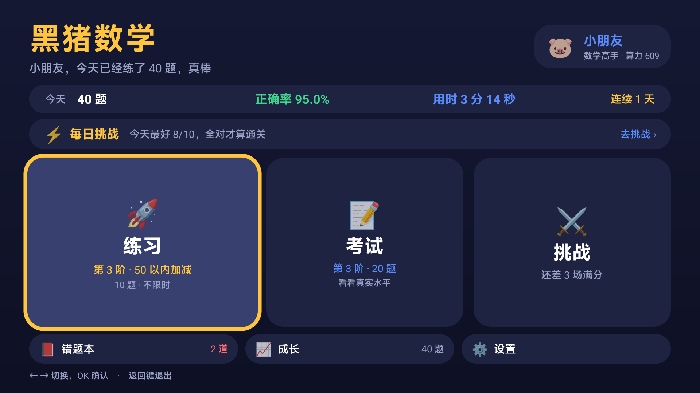
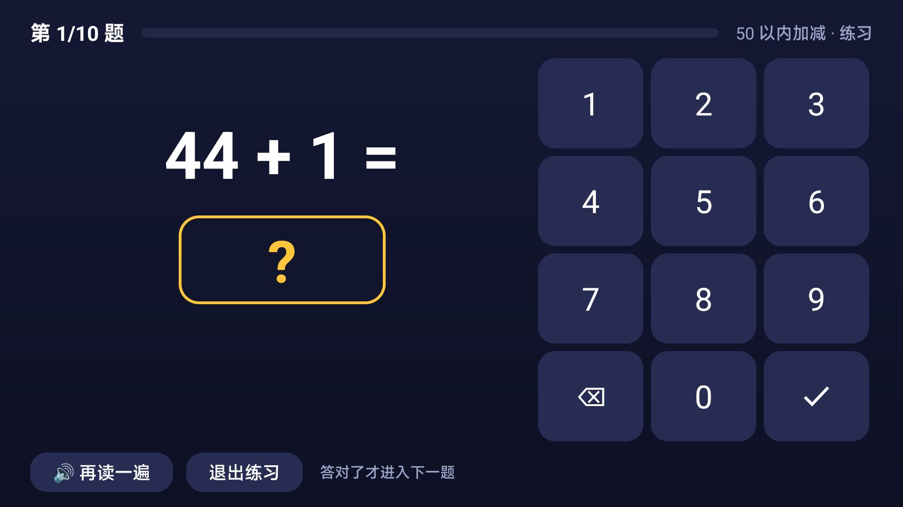
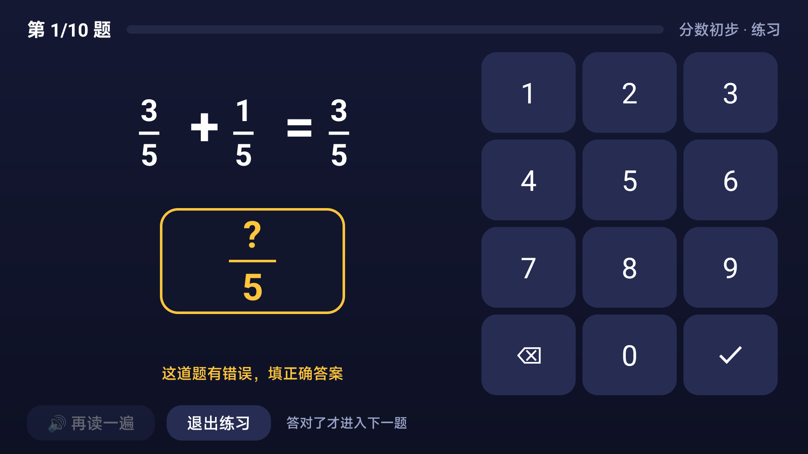
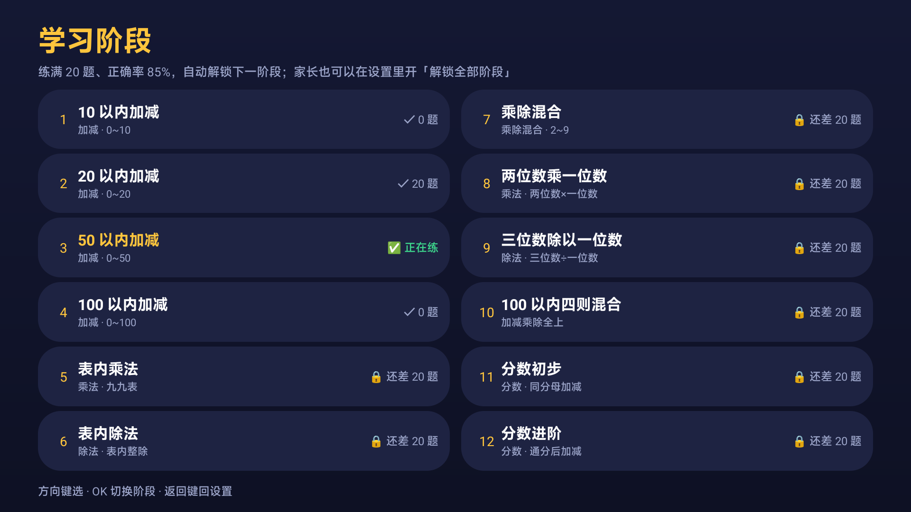
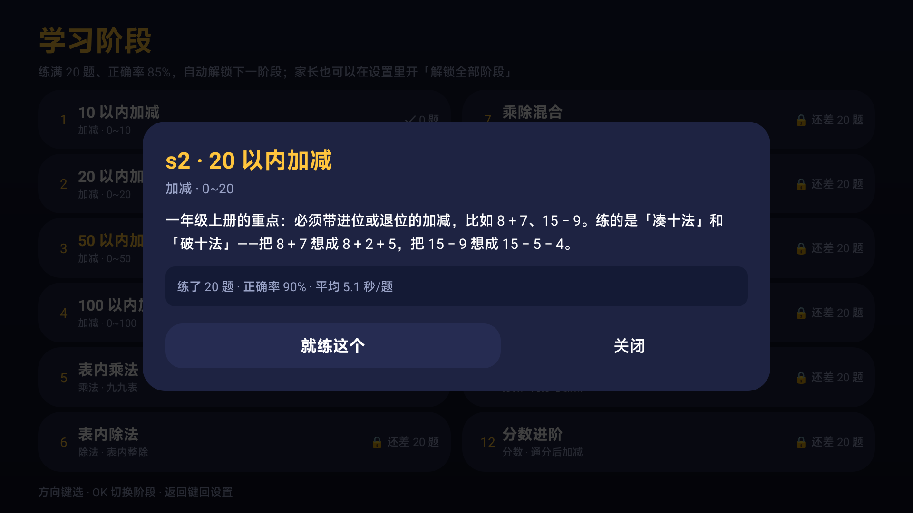
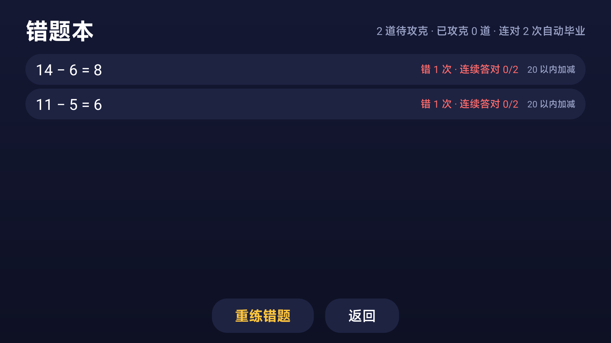
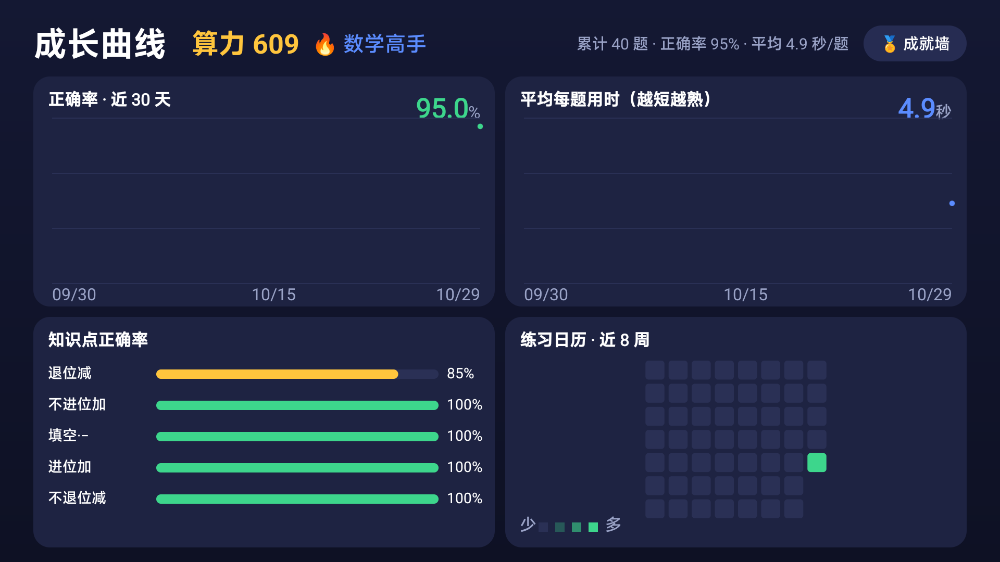
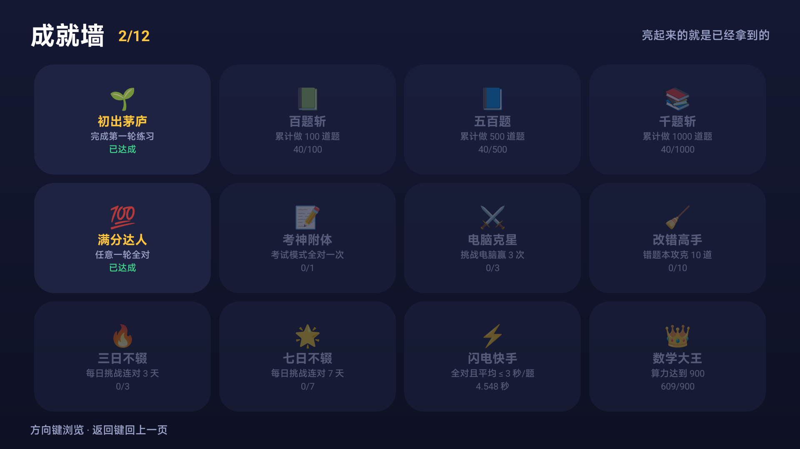
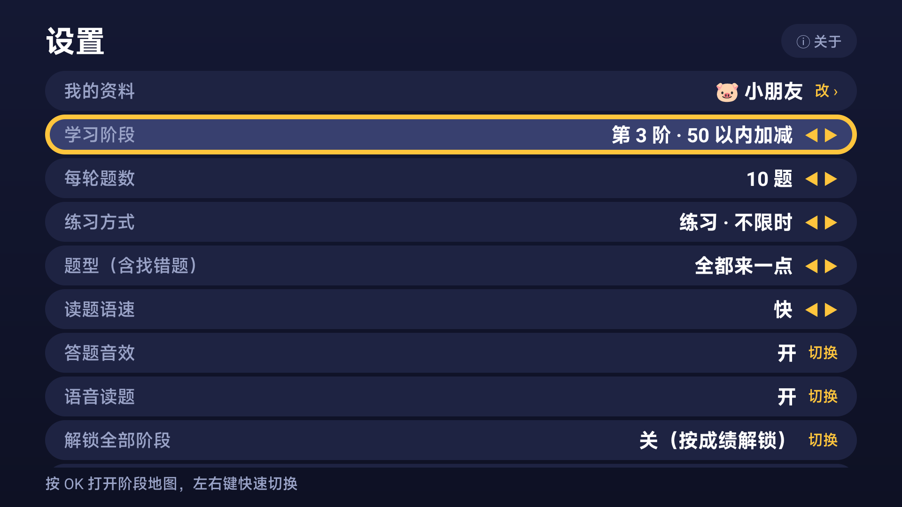
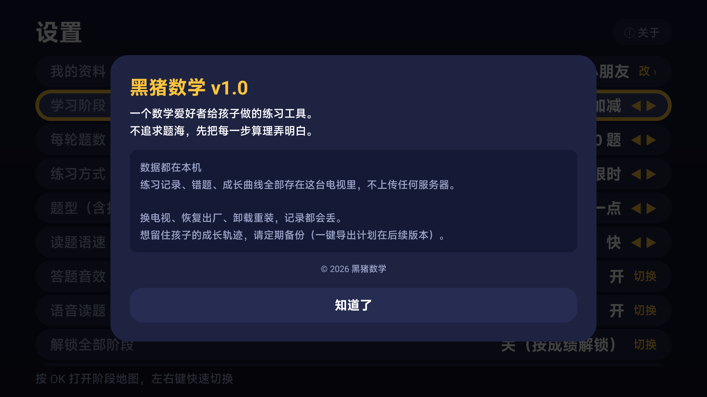

# 黑猪数学 TV

小米电视 / Android TV 上的小学数学口算闯关应用。遥控器操作，数据全部存在本机 SQLite。

- 加减乘除按小学课标拆成 **12 个台阶**，每阶只改一个变量（数域 / 进退位 / 通分）
- **答对才走**；同一个坑连错 3 次自动跳过，语音提示该补哪块，题目记进错题本
- 算力 0~1000 + 六档段位，成长曲线 / 练习热力图 / 12 个成就
- 挑战电脑：对手速度 = 孩子最近 5 场满分的平均每题用时 ×0.8



## 一、界面

| 练习（答对才走） | 分数题（真·上下结构） |
|---|---|
|  |  |

| 阶段地图（s1~s12 一屏可见） | 阶段详情（教什么、练到哪、解锁条件） |
|---|---|
|  |  |

| 结果页（解锁新阶段可以直接去练） | 错题本 |
|---|---|
|  |  |

| 成长曲线 / 知识点 / 热力图 | 成就墙 |
|---|---|
|  |  |

| 设置 | 关于（数据本地存储 + 备份提醒） |
|---|---|
|  |  |

## 二、能做什么

| 功能 | 说明 |
|------|------|
| 阶段 | 12 个台阶，从 10 以内加减到分数通分；加减同台、乘除各自独立 |
| 练习 | 首页主入口，答对才走；设置里可切换成限时（每题倒计时） |
| 考试 | 首页主入口，20 题统一判卷，用来测真实水平 |
| 题型 | 计算、找错（给个算错的式子让娃改）、填空（求括号里的数）、混着来 |
| 分数 | 真·上下结构排版（不是 1/2 斜杠）；只填分子，分母由题面给；分数不朗读 |
| 挑战电脑 | 同题竞速，电脑速度 = 最近 5 场满分的平均每题用时 ×0.8；攒够 5 场满分才解锁 |
| 每日挑战 | 每天固定一组 10 题（同一天同一套），全对点亮当天，连续打卡 |
| 错题本 | 第一次答错就收录；同一题连错 3 次自动跳过（已记错题本），连对 2 次毕业 |
| 成长曲线 | 正确率 / 速度 / 知识点正确率 / 练习热力图 |
| 算力与段位 | 0~1000 分，数学小学徒 → 数学大王 |
| 成就墙 | 12 个成就，实时判定 |
| 语音 | 内置语音包朗读题目，练习/限时/考试语速不同，带符号停顿 |
| 我的资料 | 12 个表情头像 + 24 个预设昵称；也可以用**手机扫码传自己的照片、打中文名** |

## 三、构建

环境：JDK 17、Android SDK（platform 34 + build-tools 34.0.0）、Gradle 8.7。

```bash
export JAVA_HOME=/usr/lib/jvm/java-17-openjdk-amd64
cd ~/kids-tv
~/tools/gradle-8.7/bin/gradle :app:assembleDebug
# 产物：app/build/outputs/apk/debug/app-debug.apk
```

安装到电视（需先在电视开发者选项里打开 ADB 调试）：

```bash
~/Android/Sdk/platform-tools/adb connect 192.168.1.8:5555
~/Android/Sdk/platform-tools/adb install -r app/build/outputs/apk/debug/app-debug.apk
~/Android/Sdk/platform-tools/adb shell am start -n com.mathking.tv/.MainActivity
```

## 四、阶段与题型

阶段按小学课标排成 12 个台阶，**加减是一体的（同阶段混着出），乘法和除法各自独立**：

| id | 阶段 | 考什么 | 特殊规则 |
|----|------|--------|----------|
| s1 | 10 以内加减 | 数感入门 | 只出不进位/不退位 |
| s2 | 20 以内加减 | 进位加、退位减 | 必须有进位或退位 |
| s3 | 50 以内加减 | 两位数 | 随意 |
| s4 | 100 以内加减 | 两位数综合 | 随意 |
| s5 | 表内乘法 | 九九表 | 2~9 |
| s6 | 表内除法 | 用口诀倒推 | 整除 |
| s7 | 乘除混合 | 看清符号 | 2~9 |
| s8 | 两位数乘一位数 | 拆十位再乘 | 10~99 × 2~9 |
| s9 | 三位数除以一位数 | 从高位除起 | 100~999 ÷ 2~9，整除 |
| s10 | 100 以内四则混合 | 四个符号全上 | 加减按 100 以内 |
| s11 | 分数初步 | 同分母加减 | 分母 3~10，真分数 |
| s12 | 分数进阶 | 通分 | 一个分母是另一个的倍数，答案分母固定 |

**阶段在哪看**：设置 → 学习阶段（按 OK 进「阶段地图」）。地图一屏列出 s1~s12，
每阶写着练什么、自己的成绩、还差多少解锁；点任意一阶弹出详情（完整介绍 + 成绩 + 解锁条件），
已解锁的可以直接「就练这个」切过去。

**解锁规则**：在当前阶段的**累计**成绩（不是某一局的手气）达到 20 题 + 正确率 85%，
自动解锁下一阶段；家长也可以在设置里一键「解锁全部阶段」。

**分数怎么答**：题面给出公分母，孩子只填分子。
`1/2 + 2/6 =` 后面是 `?/6`，填 5 就是 5/6。这样数字键盘就够了，不用输入分数线。

**分数怎么显示**：存储一律是 `3/4` 纯文本，展示时用 `FractionSpan`（ReplacementSpan）
画成上下结构；答案框用固定布局画（`answerFraction`），避免 TextView 行高裁掉分数的上下两行。
分数题不朗读——语音包是按整数念的，念分数反而听不明白。

## 五、语音包

电视上没有中文 TTS 引擎（实测小米电视 `tts_default_synth = null`），所以题目朗读用内置音频拼接。

音频源在 `app/src/main/assets/voice/`：
- `*.mp3`：edge-tts 生成的原件（zh-CN-XiaoxiaoNeural）
- `raw/*.raw`：转成 22050Hz 单声道 16bit 裸 PCM，运行时按 token 拼成整句播放（数字之间零间隙，符号前留 200ms）

重新生成（venv 在项目内，不污染系统）：

```bash
cd ~/kids-tv
.venv/bin/edge-tts --voice zh-CN-XiaoxiaoNeural --text "三" --write-media app/src/main/assets/voice/san.mp3
ffmpeg -i app/src/main/assets/voice/san.mp3 \
  -af "silenceremove=start_periods=1:start_silence=0.005:start_threshold=-50dB,areverse,silenceremove=start_periods=1:start_silence=0.005:start_threshold=-50dB,areverse" \
  -ar 22050 -ac 1 -f s16le app/src/main/assets/voice/raw/san.raw
```

## 六、代码结构

```
app/src/main/java/com/mathking/tv/
├── App.kt                 全局单例（Repo / Settings / Speaker）
├── MainActivity.kt        单 Activity + Fragment 导航 + 遥控器数字键转发
├── data/                  数据层
│   ├── Models.kt          数据模型与枚举
│   ├── StageCatalog.kt    阶段定义（s1~s9 可用，s10 分数进阶未开放）
│   ├── Generator.kt       出题（含找错题）与朗读文本
│   ├── DbHelper.kt        SQLite 建表与逐级迁移（当前 v3）
│   ├── Repo.kt            所有查询与写入
│   ├── Settings.kt        SharedPreferences（阶段/题数/模式/语速/解锁/名字头像）
│   └── ProfilePresets.kt  头像与预设昵称（电视和手机网页共用）
├── engine/SessionEngine.kt 一局的答题状态机（三种模式的差异都收在这里）
├── audio/                 语音包（PCM 拼接）与音效（正弦波合成）
├── net/                   手机扫码用的局域网表单服务（手写 HTTP）
├── stats/                 算力公式、段位、成就判定
├── ui/                    首页/练习/挑战/结果/错题本/统计/设置/成就/我的资料
└── util/                  dp、焦点动画、格式化
```

## 七、首页结构

```
黑猪数学                    [🐷 名字 · 段位 · 算力]   ← 点这里改资料
今天 10 题 · 100.0% · 56 秒 · 连续 1 天
⚡ 每日挑战 ─────────────────────────── 去挑战 ›
┌─────────┬─────────┬─────────┐
│  练习   │  考试   │  挑战   │   ← 孩子的主入口
└─────────┴─────────┴─────────┘
[📕 错题本]  [📈 成长]  [⚙️ 设置]      ← 家长入口，做小了
```

练习卡的副标题会跟着设置里的「练习方式」变（不限时 / 限时）；
考试固定 20 题；挑战卡显示还差几场满分或对手速度。

## 八、手机扫码填资料

电视遥控器打中文太痛苦，所以资料页里有个「手机扫码改名字和头像」：

1. 电视打开「我的资料 → 手机扫码」，起一个临时 HTTP 服务（随机端口）并显示二维码
2. 手机连同一个 WiFi，扫码打开网页：可以打中文名字、选表情头像，也可以**选一张手机里的照片**
   （浏览器端用 canvas 裁成正方形压到 256×256 JPEG 再上传，避免大图走局域网）
3. 提交后电视自动关掉资料页，回首页直接看到新名字和新头像

实现：`net/LocalWebServer.kt`，手写 GET/POST 解析，没有引 HTTP 框架；
二维码用 `com.google.zxing:core`（只引 core，不引 android 版）。
服务只在对话框打开期间运行，关掉即停，不对局域网常驻暴露。

## 九、数据

`~/kids-tv` 内的 SQLite 文件在电视上：`/data/data/com.mathking.tv/databases/mathking.db`

| 表 | 用途 |
|----|------|
| session | 每一局（阶段、模式、题数、正确数、用时、得分、算力） |
| attempt | 每一题（题面、答案、作答、是否首次答对、用时、知识点） |
| wrong_item | 错题本（错误次数、连续答对、是否毕业、知识点） |
| daily | 每日挑战（日期、题数、正确数） |
| sync_queue | 预留：网络对战成绩上报 |

数据库版本 3，升级走 `onUpgrade` 逐级 ALTER/CREATE，不会清数据。

## 十、口径约定（改代码前先看这条）

- **算力 / 今日 / 成长曲线 / 知识点统计** 全部排除 `mode='challenge'`（抢答正确率天然低，混进来会失真）
- 阶段解锁看**该阶段累计**：≥20 题且正确率 ≥85%（`Settings.UNLOCK_MIN_*`）
- 错题重练保留原始知识点，不记成「错题重练」
- 首次答对才算「做对」；重答正确只让错题本计一次 streak

## 十一、卡住就过

同一道题连错 3 次，程序会：
1. 用 1.55 倍速念一句该补的知识点（「这题先跳过。个位不够减，向十位借一当十」）
2. 200ms 后自动切到下一题——不让孩子卡死在一道题上
3. 新题上用黄字留 2 秒：「答错 3 次，这题跳过 · 已记进错题本」

答案框里记的是 3 次尝试、首次未答对，所以这题一定会出现在错题本里。

## 十二、关于 / 数据备份

设置页右上角「ⓘ 关于」：版本、产品定位、以及一条重要提示——**所有数据都存在这台电视本地，
换电视 / 恢复出厂 / 卸载重装都会丢**，想留住孩子的成长轨迹要定期备份（一键导出计划在后续版本）。

## 十三、已知边界

- 分数进阶（s10）在代码里是 `available = false`，UI 不展示
- 网络对战未实现，`sync_queue` / `session.player_id` 是为它留的
- 无数据导出/备份，卸载或换电视会丢记录
